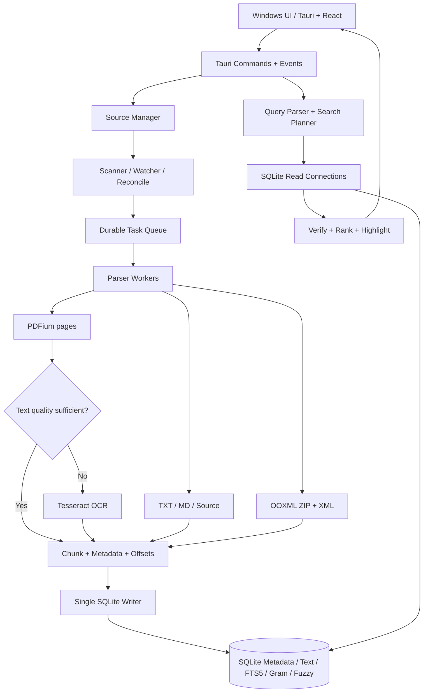

# IndexFox 本地全文检索器 — V1.0 技术设计方案

> 状态：需求确认版 · 日期：2026-11-20  
> 平台：Windows x64 · 交付：解压即用的便携目录（不提供安装包）  
> 核心目标：对指定目录中的 TXT、PDF、MD、DOCX 及常见代码/配置文本进行本地内容检索；支持精确、子串、拼写容错、OCR 和右侧预览。  
> **本文是实现设计与验收约定，并非已完成的程序或经基准测试的性能报告。**

## 0. 项目名称与命名规范

| 项目 | 约定 |
|---|---|
| 英文产品名称 | **IndexFox** |
| 中文产品名称 | **索引狐** |
| 内部项目/仓库目录 | `indexfox` |
| Windows 主程序 | `IndexFox.exe` |
| 应用窗口标题 | `IndexFox · 索引狐` |
| 默认数据目录 | `%LOCALAPPDATA%\IndexFox\` |
| 默认索引数据库 | `%LOCALAPPDATA%\IndexFox\data\index.db` |
| 默认配置目录 | `%LOCALAPPDATA%\IndexFox\config\` |
| 便携发行包名 | `IndexFox-windows-x64-portable.zip` |
| Rust crate 命名前缀 | `indexfox-` |
| Tauri 应用标识（暂定） | `com.indexfox.desktop` |

**命名决议**：用户已选定 IndexFox（索引狐）；在代码、UI、CLI、日志、安装/运行说明及打包流程中保持一致，不再使用旧工作名。英文名与应用标识只是项目内部约定，**尚未验证 GitHub 仓库可用性、商标或应用标识唯一性**，对外发布前需核查；如遇冲突应统一调整。

**品牌元素**：图标可考虑狐狸 + 放大镜或索引符号，但图标设计尚未确认，不能作为开发阻塞项。


## 1. 已确认需求（21项）

| 编号 | 需求 | 结论 |
|---|---|---|
| 01 | 模糊定义 | C：子串匹配 + 拼写/错字容错 |
| 02 | 数据规模 | B：1–10万文件；20–200GB 原始数据 |
| 03 | OCR | C：自动按页 OCR 兜底；设置开关 |
| 04 | 存储来源 | D：本地磁盘、NAS/SMB、WSL、移动设备 |
| 05 | 索引范围 | C：支持整盘，但**默认只手动添加目录**；首次无索引根目录 |
| 06 | 退出行为 | C：退出/托盘模式都支持；默认关闭即退出 |
| 07 | 结果视图 | C：列表 + 右侧文档预览与高亮 |
| 08 | DOCX 预览 | A：仅纯文本、段落/表格文本，不还原排版 |
| 09 | 查询表达式 | C：AND、OR、引号短语、排除、括号 |
| 10 | 单文件大小 | D：可配置，**默认100 MB**；超限仍可按文件名搜索 |
| 11 | 索引路径 | C：默认 LocalAppData，可修改并迁移 |
| 12 | 资源模式 | C：节能/均衡/高速；默认均衡 |
| 13 | 检索时延 | D：不设硬性时延 SLA，重点正确性与稳定性 |
| 14 | 扩展格式 | B：常见源码、日志、配置格式 |
| 15 | 结果排序 | C：默认相关度，提供日期、路径、大小、文件名、命中数 |
| 16 | 分发 | B：只做 Windows x64 便携版 |
| 17 | OCR引擎 | C：Tesseract 默认；预留 PaddleOCR 插件 |
| 18 | 搜索触发 | A：只在 Enter 或点击搜索按钮时执行，不做输入实时搜索 |
| 19 | 历史记录 | B：最近100条，可关、可清理、自动去重 |
| 20 | 索引加密 | A：普通 SQLite，无内建加密；文件系统权限控制 |
| 21 | 字体修改 | A：读取本机系统已安装字体；支持自定义界面字体、预览/代码字体及字号，支持恢复默认 |

## 2. 约束及范围

### 必须实现
- 仅本地处理，不上传文件、文本、日志或搜索历史；原始文件只读。
- 精确连续子串与近似拼写为**不同搜索行为**：不能把近似匹配混入严格精确结果。
- 英文标识符（如 `VIDIOC_STREAMON`、`dma_alloc_coherent()`、`#include`）、中文双字（如“驱动”）均应正确命中。
- 每个结果指明源文件与命中位置；PDF 至少定位页号；TXT/MD/代码定位行号；DOCX 定位段落或表格单元。
- 搜索覆盖已经完成索引且未被用户排除的文件；当前正在索引或已跳过的内容不得误示为“已全文覆盖”。
- 文件源断连不能触发批量误删；索引数据库重启后保持有效。

### 不在 V1.0 交付范围
- AI/语义向量搜索、云端同步、多用户服务端、内容编辑、Office 原样排版、图片集 OCR、复杂 PDF 表格结构化识别、Windows Search 集成。
- 文件内 PDF OCR 字形/扫描页高亮精度以识别引擎坐标为限，不承诺像原生文字层一样逐字精确。
- 拼写容错是编辑距离意义的近似查找，不承诺识别同义词、语义或中文语境。
- 支持 WSL UNC 目录不代表可以离线读取已经关闭的 WSL 实例；离线只保留已索引文本预览。

## 3. 总体架构



**进程模型**：主进程 `IndexFox.exe` 承载 Tauri UI 和 Rust 后台任务；PDF 解析与 OCR 等高风险/重负载处理支持独立子进程隔离、超时与崩溃重试。SQLite 单写多读，使用 WAL 模式。若关闭即退出，则所有后台工作停止并持久化未完成队列；启用托盘则窗口关闭后进程继续运行。

**模块边界**：UI 只调用命令并订阅事件；扫描器不直接改索引；解析器只产出结构化文本；搜索器只读已提交版本；索引写入器事务性替换文件内容。

## 4. 技术选型

| 模块 | 选型 | 说明 |
|---|---|---|
| UI | Tauri 2 + React + TypeScript | 便携原生窗口与托盘；不运行单独 HTTP 服务 |
| 核心语言 | Rust stable | 检索、I/O、并发调度、任务管线 |
| 持久化 | SQLite + FTS5 trigram + 辅助索引 | 不单纯依赖 trigram 处理1~2字查询 |
| 文本编码 | encoding_rs + BOM/编码探测 | 优先 UTF-8/UTF-16；GBK兜底；展示解码失败提示 |
| DOCX | ZIP 解包 + XML 流式解析 | 正文、表格、标题；关注段落 run 合并 |
| PDF | PDFium 封装 | 文本提取、页码、文本区域、页面渲染 |
| OCR | Tesseract + chi_sim/eng 数据 | PDFium 页面渲染图输入；不是直接把 PDF 文件喂给 Tesseract |
| 目录变化 | notify + 轮询对账 | 本机文件系统事件；NAS/WSL 轮询与断连判定 |
| 字体枚举 | Windows DirectWrite / GDI + WebView2 | 读取本机系统已安装字体列表，供界面与代码预览字体配置；缺失时自动回退默认字体栈 |
| 日志 | tracing | 本地滚动日志，默认不记录文档全文 |
| 测试 | Rust unit/integration + UI E2E | 重点中文、技术标识符、增量索引、异常恢复 |

### Windows 便携版关键约束
Tauri 在 Windows 上依赖 Microsoft Edge WebView2 Runtime；它与 Edge 浏览器程序不是同一概念。为了满足“解压即用”，建议发行**独立携带 Fixed Version WebView2 Runtime 的便携包**，并测试在未预装 Evergreen Runtime 的干净系统上运行。代价是发布包明显增大，运行时需要跟进安全更新。无需安装 Microsoft Word 或 Acrobat。发布前检查 PDFium/Tesseract/运行时及各模型的再分发许可和第三方声明。

## 5. 文件源与扫描

### Source 源类型
- `local`：`C:\\`、`D:\\Docs` 等；优先系统事件 + 启动时核对。
- `smb`：`\\\\nas\\share\\docs` 等；主要轮询扫描，可尝试事件但不可只依赖事件。
- `wsl`：`\\\\wsl.localhost\\Ubuntu\\home\\...`；主要轮询扫描；WSL 停机视为离线。
- `removable`：可移动盘；盘符改变应明确告知；优先稳定卷标识识别，必要时用户重绑定。

每源配置：启用状态、递归、文件扩展名白名单、目录/通配排除、大小上限、更新策略、轮询周期、离线时是否保留索引（默认保留）。重叠根目录去重，不重复索引同一逻辑文件。

### 扫描对账与误删保护
1. 枚举根目录、检查可读性；不可访问标记 `offline`，**不删除旧记录**。
2. 记录本次扫描 generation 和完成状态；仅当根目录完整、无致命枚举错误后，允许清除“确认已不存在”的文件索引。
3. 创建/修改：对比相对路径、大小、mtime 和可选抽样指纹；存在不确定性时重新解析。
4. 连续写入文件延迟并合并事件，避免读取半成品；解析前后再次核验 mtime/size，不一致则重新排队。
5. 目录排除 `.git`、`node_modules`、`.venv`、`target` 等可编辑；默认不跨越目录 junction / symlink 循环。
6. 文件 rename 通过稳定文件 ID（若可获取）或内容指纹协助识别，无法确定则按删除+新增处理。
7. Windows/SMB 路径按文件系统规则做大小写和规范化；WSL Linux 目录保留大小写敏感性；原始显示路径不丢失。

## 6. 文档解析与定位

### 统一产出格式
`ExtractedDocument { file_id, extractor_version, sections[] }`；每个 section 至少含 `text`、`kind`、`source_locator`（页码/行号/段落）、`original_char_offsets`、`origin`（native/ocr）、可选 bbox 坐标与 OCR 置信度。

- **纯文本**：按 BOM/编码推断，保留换行和行号；Markdown 同时允许源码预览与渲染预览。
- **PDF**：逐页文本层提取，保留页号和文本片段位置信息；识别无文本、乱码、稀疏/质量差的页时执行 OCR。混合 PDF 只重识别需要的页，避免重复文字进入索引。
- **DOCX**：OOXML 解压，按段落和表格单元提取并合并多个 run；支持常见的页眉页脚/脚注作为可选增强，默认不追求排版分页。
- **扫描 PDF**：PDFium 逐页渲染到临时图像，送 Tesseract，保留 OCR 文本和可用的文字区域；文本定位不应改写原 PDF。

**OCR 任务资源**：默认开启 OCR、默认中英、并发2；可调 DPI（建议先从200~300基准测试）、限制单页像素/超时/重试、缓存由原文件指纹+页码+OCR 引擎版本+语言+渲染配置构成。超大页面按比例缩放，避免一次性占用大量 RAM。

**100MB 上限**：按原始文件大小判断，默认只索引元数据，状态 `skipped_size`；可由用户对单文件强制索引；超限强制任务依旧受内存/超时保护。

## 7. 分块与查询一致性

索引单位是 `chunk` 而非整个文件。文本按段落/行边界进行分块，初始建议目标 2–8 KiB 文本，最大 16 KiB，重叠区 256–512 个 Unicode 字符（需基准测试）；PDF 先保持页边界，页内超长再切块。原始文本与规范化文本分开保存，另存偏移映射以便准确高亮。

**严格语义**：
- 精确模式：连续子串/引号短语，不允许删字或交换字符；可选区分大小写。代码标点按字面字符处理；保留 `_`、`.`、`(`、`)` 等。
- 默认比较：大小写不敏感（至少 ASCII）；不默认删掉下划线、空格、括号或将中文词进行语义替换。
- 连续子串可以跨 chunk 边界：查询层通过相邻 chunk 拼接核对；不能只依赖块级 FTS `MATCH`，否则长短语可能漏检。
- 搜索表达式的 AND/OR/NOT **在文件级别** 求值；一个文件不同位置分别命中两个词也满足 AND；显示具体命中位置。
- 对含 `%`、`_` 等 SQL 通配符的用户输入先进行字面匹配计划，不能直接拼入 `LIKE` 当通配符；SQL 语句一律使用参数绑定。
- 特殊边界（跨 PDF 页、跨 DOCX 单元格）的“连续短语”遵循统一拼接策略并显式记录分页/段落分隔符，测试要覆盖。

## 8. 检索引擎与匹配算法

### 三种模式
1. `exact`：严格连续短语/子串校验，大小写选项；无拼写容错。
2. `substring`：任意位置包含输入片段，默认不区分 ASCII 大小写；与 `exact` 的区别主要是用户语义与默认比较配置，底层可共享候选召回和校验逻辑。
3. `fuzzy`：先召回候选词，再用编辑距离（例如 Damerau-Levenshtein）确认拼写/错字相似度；返回相似度解释和原文命中词，默认精确结果优先。**不做无边界的整篇正文模糊对比**。

### 多层召回
- `>=3 Unicode 字符`：FTS5 trigram 快速候选；对长连续短语、跨块条件再原文核对。
- **2 字符**：自建 gram→chunk_id 的辅助倒排索引，保证如“内核”“驱动”“C+”等可查，不交给 trigram 全表扫描。
- **1 字符**：单字/字符的 gram→chunk_id 辅助倒排（可按 chunk 去重存储）；限制首屏数量并按源/格式过滤。必要时分批扫描已索引文本补救，**不允许静默漏检**。
- `fuzzy`：建立独立 `lexeme` 词典与词片段索引。英文/代码标识符保留完整 token 与常见拆分形式；中文以字符 n-gram 为候选特征，不依赖简单空格分词。候选经过长度范围、最小共享 gram 数与编辑距离校验，再回查命中 chunk。

### 查询语法及解析器
```text
Linux 驱动                   # 隐式 AND
Linux OR Windows            # OR
"Linux kernel"              # 连续短语
Linux -Windows              # 排除词
(Linux OR Windows) 驱动      # 括号
"VIDIOC_STREAMON"           # 标识符整体匹配
```
解析为显式 AST（`Term/And/Or/Not/Group`），先规范化词面、验证括号，再生成查询计划。括号、双引号、运算符解析失败应向用户报告输入位置；不要把用户输入当 FTS5 查询语言直接执行。短语内内容按字面保留；中英文标点和前导连字符有明确转义规则。

### 排序
优先级：文件名精确 > 正文严格连续 > 子串 > 容错。相关度再综合文档字段权重、最优编辑距离、命中位置接近程度、命中数（对长文件进行归一化）等；其他排序字段可选修改时间、大小、路径、文件名、命中数。每次查询展示实际返回数、匹配文件数（可能延迟完成统计）及实际耗时。

### 语义上的准确性目标
- **严格命中**：对“已成功完成索引的文本”不应产生误报；跨块不应漏检，需自动化验证。
- **OCR**：受识别错误限制，不能承诺一定找到扫描文档上的真实文字。
- **模糊**：通过阈值和相关度提高可用性，不能承诺零误报。
- **尚未索引/超过限制/解析失败/源离线**：界面应区分状态，避免用户认为全库无匹配。

## 9. SQLite 数据模型（逻辑结构）

关系：`sources 1:N files`、`files 1:N chunks`、`chunks 1:1 chunks_fts`、`files 1:N index_jobs`。搜索历史是独立表。

```sql
PRAGMA foreign_keys=ON;
PRAGMA journal_mode=WAL;

CREATE TABLE sources (
  id INTEGER PRIMARY KEY,
  kind TEXT NOT NULL CHECK(kind IN ('local','smb','wsl','removable')),
  root_path TEXT NOT NULL,
  enabled INTEGER NOT NULL DEFAULT 1,
  online_state TEXT NOT NULL DEFAULT 'unknown',
  scan_mode TEXT NOT NULL DEFAULT 'auto',
  last_success_scan_at TEXT,
  config_json TEXT NOT NULL DEFAULT '{}'
);

CREATE TABLE files (
  id INTEGER PRIMARY KEY,
  source_id INTEGER NOT NULL REFERENCES sources(id),
  path_key TEXT NOT NULL,                 -- 按来源规则规范化，不等于展示路径
  display_path TEXT NOT NULL,
  filename TEXT NOT NULL,
  ext TEXT NOT NULL,
  size_bytes INTEGER NOT NULL,
  mtime_ns INTEGER,
  content_fingerprint TEXT,
  state TEXT NOT NULL,                    -- indexed/pending/failed/skipped_size/offline
  indexed_at TEXT,
  error_message TEXT,
  UNIQUE(source_id, path_key)
);

CREATE TABLE chunks (
  id INTEGER PRIMARY KEY,
  file_id INTEGER NOT NULL REFERENCES files(id) ON DELETE CASCADE,
  ordinal INTEGER NOT NULL,
  text TEXT NOT NULL,                     -- 可检索的规范化文本
  display_text TEXT NOT NULL,             -- 可显示/高亮的原文本
  source_locator_json TEXT NOT NULL,     -- 页码/行号/段落/偏移/bbox
  origin TEXT NOT NULL,                   -- native/ocr
  UNIQUE(file_id, ordinal)
);

-- external-content FTS；由同一个数据库写入事务同步维护，而非依赖异步修复
CREATE VIRTUAL TABLE chunks_fts USING fts5(
  text, content='chunks', content_rowid='id', tokenize='trigram'
);

CREATE TABLE short_grams (
  gram TEXT NOT NULL,
  chunk_id INTEGER NOT NULL REFERENCES chunks(id) ON DELETE CASCADE,
  PRIMARY KEY(gram, chunk_id)
) WITHOUT ROWID;
CREATE INDEX idx_short_grams_chunk ON short_grams(chunk_id);
CREATE INDEX idx_chunks_file ON chunks(file_id, ordinal);

CREATE TABLE search_history (
  id INTEGER PRIMARY KEY,
  query_text TEXT NOT NULL,
  search_mode TEXT NOT NULL,
  filters_json TEXT NOT NULL,
  last_used_at TEXT NOT NULL,
  UNIQUE(query_text, search_mode, filters_json)
);

CREATE TABLE index_jobs (
  id INTEGER PRIMARY KEY,
  file_id INTEGER REFERENCES files(id),
  source_id INTEGER NOT NULL REFERENCES sources(id),
  kind TEXT NOT NULL,
  state TEXT NOT NULL,                    -- queued/running/failed/done
  attempt_count INTEGER NOT NULL DEFAULT 0,
  requested_at TEXT NOT NULL,
  last_error TEXT
);
```

**数据库实施要点**：以上为逻辑 DDL 草案，落地应由版本化 migration 管理。需要添加 `lexemes`、`lexeme_grams`、`lexeme_occurrences`（含字典词与命中映射）和 `app_meta`/扫描 generation 等表；是否持久化全部 OCR bbox/原文偏移表可在原型验证后确定。FTS5 external-content 索引必须在同一事务里正确同步增删，否则会产生幽灵命中；`short_grams` 的大小需实测，不宜在未测试前承诺索引体积。并发使用单写多读 + WAL，数据库迁移必须阻止运行中的读写并进行一致性验证。

**文件内容替换事务**：先在内存/临时文件完成解析，确认文件未变化；开启事务删旧 FTS/短词/词典关联及 chunks，写新 chunks 和全部索引、更新 files 状态，成功 commit 后一次性可见。失败 rollback 并保留旧索引版本（标记 stale）。

## 10. 界面与交互

```text
┌─────────────────────────────────────────────────────────────────────────────────┐
│ IndexFox   [ 搜索关键词...................................... ] [搜索] ⚙    │
│ 模式: 精确 / 子串 / 拼写容错   排序: 相关度 ▾   过滤: PDF TXT MD DOCX ...         │
├──────────────────────┬───────────────────────────┬──────────────────────────────┤
│ 已索引目录           │ 搜索结果 (文件列表)        │ 预览                         │
│ D:\Docs       ●      │ 1. Linux DMA API.pdf       │ PDF 第38页 / 关键词高亮       │
│ \\nas\docs     ○      │ ...dma_alloc_coherent...    │ 或原文文本 / OCR 识别文字     │
│ \\wsl.localhost...   │ 2. camera_driver.c         │                              │
│ [ + 添加目录 ]       │ ...buf_queue...            │ [上一个命中] [下一个命中]     │
├──────────────────────┴───────────────────────────┴──────────────────────────────┤
│ 找到 N 份文件 | 已展示 M 条命中 | 真实耗时 t | 索引 8,471 / 10,214             │
└─────────────────────────────────────────────────────────────────────────────────┘
```

- 仅 Enter/搜索按钮触发；编辑输入框不会自动查询。
- 结果默认相关度；多结果按文件聚合，展开命中片段；键盘上下选择、Enter 打开、预览中跳转上下命中。
- 预览：TXT/代码带行号；MD 源码/渲染切换；PDF 以真实页面渲染，按页定位；DOCX 只展示文本/段落；源离线只显示已经缓存的文本。
- 索引管理：查看每源在线状态、队列数、跳过原因、错误详情、增量更新、暂停与重建。
- 设置：索引根目录、排除规则、OCR 开关/语言/并发、节能/均衡/高速、索引路径迁移、字体设置（读取本机系统已安装字体列表，支持分别修改界面字体、文本/代码预览字体及预览字号，支持一键恢复默认；当配置字体不存在时平滑回退系统默认字体栈）、开机启动、托盘行为、清理历史与缓存。
- 搜索历史最多100条，保存表达式/模式/过滤参数；禁用时不写入，支持全部清空。

## 11. 资源管理、故障恢复和安全

- 索引模式是可调度配置，不承诺固定 CPU 占用百分比；默认均衡，后台独立索引队列，查询任务优先。
- 同时 OCR 默认最多2页；文件解析按内存预算并发，PDF 光栅化设置最大像素和超时。
- SQLite 使用 WAL 和事务；索引替换原子化，崩溃恢复未完成 `running` 作业为 `queued` 并按重试上限处理。
- 目录/文件不可读、损坏 DOCX/PDF、OCR 失败、磁盘不足、路径过长、NAS 突然断连、WSL 停止：分别记录失败原因，不能造成数据库整体损坏。
- 便携包不应因管理员权限才能打开；不创建自启动或计划任务，除非用户显式选择。
- 仅原始文件只读；禁止外部网络请求（软件更新检查也默认无）；日志对路径可采取脱敏开关，不记录正文。
- 对潜在恶意文档采取解析进程隔离、合理超时/内存限额，并维护 PDFium/Tesseract 更新；绝不把 OCR 命令参数用字符串拼接给 shell。
- 数据库不加密；用户需知道复制 `.db` 文件等同于复制可检索文本副本。

## 12. 验收原则与待量化指标

V1.0 不设置固定毫秒 SLA，但要持续记录：总扫描文件数、成功率、按源/格式成功率、跳过率、索引数据库体积、首次/增量索引速度、查询延迟 P50/P95、OCR 单页耗时、峰值内存、异常数。

**正确性基准**：用有明确 ground truth 的测试集，分别验证精确/子串完全命中与无误报；容错计算 top-k 召回率与无关命中率。所有验收需要包含至少 1 万和 10 万文件模拟规模的性能基准，且逐级扩充，以测试机器数据为准；真实用户 20–200GB 数据集的完整时间及占用不预先保证。

## 13. 主要风险与缓解

| 风险 | 缓解方案 |
|---|---|
| FTS5 trigram 不支持1/2字符高效检索 | 单字/双字辅助索引，并做回归测试 |
| 错拼容错召回过大 | 候选先粗筛、再编辑距离验证，设置排序阈值和分页 |
| 中文和代码混合 token 不规则 | 词典/tokenizer 分离，保留标识符原样，测试技术标记 |
| 文件跨 chunk 连续匹配漏检 | 重叠切块 + 相邻块拼接与校验 |
| NAS/WSL 断连造成误删除 | 显式 offline 状态、完整扫描确认后才清理 |
| 扫描 PDF 占用高 | 按页 OCR、并发/像素/时限限制、缓存 |
| DOCX 图片/复杂内容无法搜索 | 明确只解析支持的文字内容，不谎报全内容覆盖 |
| WebView2 缺失影响“免安装” | 发行包包含合法可分发的 Fixed Version Runtime 并验证 |
| SQLite/FTS 索引不同步 | 原子事务 + 重建检验机制 |
| PDFium/Tesseract 动态库崩溃 | 隔离、超时、重试、错误上报 |

## 14. 推荐的交付阶段

- **M0 技术验证**：确认 ZIP 原生便携方案、PDFium、Tesseract、trigram/短词索引；有可运行的最小端到端样例。
- **M1 检索核心**：四种格式解析、SQLite、单/双/三字符与精确子串、AND/OR/NOT、索引完成一致性。
- **M2 桌面体验**：Tauri GUI、右侧文本/PDF/DOCX预览、高亮、排序、历史、目录管理。
- **M3 生产可靠性**：文件变更、NAS/WSL、离线保留、索引重试、限流、托盘与迁移。
- **M4 OCR 和容错完整交付**：按页 OCR + 缓存、容错词典/排序、压测、异常测试及 x64 便携打包。

> 说明：为防止 UI 与高成本算法互相阻塞，推荐先让纯 Rust CLI 测试程序跑通 M1，再集成 Tauri 界面。后续 Codex 的每个阶段均以单测/集成测试通过为合并条件。

## 15. 参考资料（官方优先）

1. SQLite FTS5：<https://www.sqlite.org/fts5.html>（trigram、LIKE/GLOB 和短字符限制）
2. Tauri 2 Windows prerequisites：<https://v2.tauri.app/start/prerequisites/>
3. Microsoft WebView2 Runtime 分发：<https://learn.microsoft.com/en-us/microsoft-edge/webview2/concepts/distribution>
4. Rust notify：<https://docs.rs/notify/latest/notify/>
5. Tesseract OCR 命令行与数据格式：<https://tesseract-ocr.github.io/tessdoc/Command-Line-Usage>
6. Tesseract 输入格式：<https://tesseract-ocr.github.io/tessdoc/InputFormats.html>
