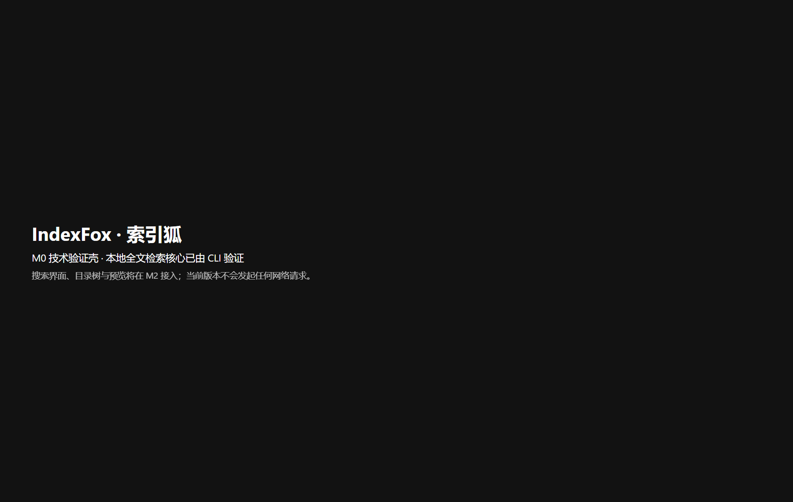
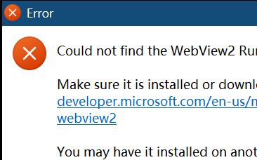

# IndexFox M0 技术验证报告

> 日期：2026-11-21  
> 结论：**M0 的核心链路、Windows x64 CLI、最小 GUI 便携包、Fixed WebView2、Windows 真实 Tesseract、本地/SMB/WSL UNC 路径均已实际验证。** 仍无法在本机验证：完全无 Evergreen 的干净 Windows（Fixed Runtime 已单独验证）、SMB 断连后的 offline 行为（M3）、托盘/字体与完整 GUI 功能（M2–M4）。

## 1. 环境

### Linux（构建与自动化测试）

| 项 | 值 |
|---|---|
| 内核 | `Linux 6.18.40.1-microsoft-standard-WSL2` |
| Rust | `rustc 1.98.1` / `cargo 1.98.1` |
| SQLite | `3.46.0`（`rusqlite 0.32` bundled，含 FTS5 trigram） |
| PDFium | `bblanchon/pdfium-binaries` build `160.0.8165.0`（Linux x64） |
| Tesseract | 5.5.0 便携解包 + `eng`/`chi_sim`（仅用于验证，未入库） |
| Node / npm | 22.23.4 / 10.9.9 |

### Windows（真实运行验证）

| 项 | 值 |
|---|---|
| OS | Windows 11 Pro `10.0.26300` x64 |
| PowerShell | 5.1.26100.9444 |
| WebView2 Runtime | Evergreen `157.0.4341.60`；另下载 Fixed Runtime `158.0.4370.33` 验证 |
| Tesseract（Windows） | 5.3.0.20221214（NSIS 解包）+ `chi_sim`/`eng`，仅用于验证 |
| 交叉编译 | `x86_64-pc-windows-gnu` + MinGW GCC 13 + `WebView2Loader.dll` |
| Windows 侧 Rust/Node/MSVC | 均未安装；产物由 WSL 交叉编译 |

## 2. 分项结果

### M0.1 Workspace + Tauri 最小窗口 + Windows ZIP

- 6 个 crate 的 workspace 与 CLI 已完成；`cargo check --workspace`、`cargo clippy --workspace --all-targets` 无警告。
- GUI 用 MinGW 交叉编译为 PE32+：`IndexFox.exe` 约 20 MB；CLI 约 5.6 MB。
- `scripts/build-windows.sh` 组装 `target/IndexFox-windows-x64-portable.zip`（约 12 MB），内含：
  `IndexFox.exe`、`indexfox-cli.exe`、`WebView2Loader.dll`、`pdfium.dll`、`README.txt`。
- 在 Windows `%TEMP%` 解压后通过 PowerShell 启动，窗口标题为 `IndexFox · 索引狐`，WebView2 子进程正常创建，嵌入的前端页面渲染成功（CDP 截图）。


- **打包要点**：Tauri 动态链接 `WebView2Loader.dll`。缺少该 DLL 时进程会存活但永远不创建窗口；不能只复制 EXE。已写入构建脚本。
- 当前依赖系统已安装的 Evergreen WebView2；**未打包 Fixed Version Runtime**，因此“无 WebView2 的干净系统”仍未验证。
- 本次 GUI 使用 GNU target + MinGW 交叉编译，不是 Tauri 官方 Windows MSVC 发布链；正式发布前需在 Windows CI/MSVC 上复核。

### M0.2 WebView2 缺失行为与 Fixed Runtime

- 本机 Evergreen WebView2 `157.0.4341.60` 可用，GUI 正常。
- **Fixed Runtime 已验证**：下载 `Microsoft.WebView2.FixedVersionRuntime.158.0.4370.33.x64.cab`，解包到独立目录，设置 `WEBVIEW2_BROWSER_EXECUTABLE_FOLDER` 后启动 GUI：
  - `msedgewebview2.exe` 进程来自 Fixed Runtime 目录；
  - CDP `navigator.userAgent` 为 `Edg/158.0.0.0`（Evergreen 为 157）。
- **缺失行为已验证（模拟）**：把该环境变量指向空目录后启动，弹出错误对话框 “Could not find the WebView2 Runtime…”，进程保持运行但不显示主窗口。



- 仍无法验证“全新 Windows 且从未安装 Evergreen”的真实机器；本机通过空目录强制失败模拟了该路径。Fixed Runtime 目录约 946 MB，是否随包分发需在 M4.7 权衡体积/许可。

### M0.3 SQLite FTS5 trigram + 短词

命令：`cargo run -p indexfox-cli -- fts-demo`（内存库、合成文本）。Windows exe 同样通过。

| 查询 | FTS5 trigram | short_grams | 最终文件数 |
|---|---:|---:|---:|
| `内` | 0 | 1 | 1 |
| `内核` | 0 | 1 | 1 |
| `内核驱动` | 1 | 1 | 1 |
| `VIDIOC_STREAMON` | 1 | 1 | 1 |
| `dma_alloc_coherent()` | 1 | 1 | 1 |
| `#include` | 1 | 1 | 1 |
| `100%` | 1 | 1 | 1 |
| `a_b` | 1 | 1 | 1 |
| `linux` / `Linux` | 1 | 1 | 1 |
| `Linux kernel`（不连续） | 0 | 0 | 0 |

结论：FTS5 trigram 对 1–2 字符返回 0（符合预期），由 `short_grams` 覆盖；`%`、`_`、括号、`#` 按字面匹配。跨 chunk 短语（含 2+2 分块）通过三方窗口召回并严格核对。

### M0.4 PDFium 多页提取与渲染

**Linux**：

```text
$ PDFIUM_LIB_PATH=.deps/pdfium/lib/libpdfium.so \
  cargo run -p indexfox-cli -- extract fixtures/pdf/sample.pdf
extractor  m0-1
encoding   pdfium
sections   3
  1 PDF p.1  IndexFox PDF fixture page one
  2 PDF p.2  VIDIOC_STREAMON dma_alloc_coherent() page two
  3 PDF p.3  Linux kernel driver page three

$ ... pdf-render fixtures/pdf/sample.pdf --page 2 --out page2.png
rendered 1600x2071
```

**Windows**：把 `pdfium.dll` 放在 `IndexFox.exe` 同目录后，Windows CLI 同样完成 3 页提取、页码定位与 1600×2071 PNG 渲染；搜索结果返回 `PDF p.2`。

### M0.5 Tesseract OCR

- 适配器：外部进程、参数直传（不走 shell）、输出临时文件、超时 `kill()`。
- **Linux 真实 OCR 已验证**：Tesseract 5.5.0 + `chi_sim`/`eng`，对纯图像页 PDF 执行 PDFium 渲染 → PNG → OCR → 索引；`内核驱动`、`VIDIOC_STREAMON` 命中，`origin=ocr`，页码 1。
- **Windows 真实 OCR 已验证**：将 UB Mannheim `tesseract-ocr-w64-setup-v5.3.0.20221214.exe` 用 7-Zip 解包，补入 `chi_sim.traineddata`；Windows CLI 对 `scanned_zh.pdf` 执行 `--ocr` 后：
  `indexed=1`、`failed=0`；查询 `内核驱动` 命中，`"origin": "ocr"`，页码 1。
- 另用假 `tesseract.exe` 验证 `--timeout 1` 时约 1.1 秒内杀死子进程。
- 复现测试（Linux）：设置 `TESSERACT_PATH`、`TESSDATA_PREFIX`、`LD_LIBRARY_PATH`、`PDFIUM_LIB_PATH` 后运行 `cargo test -p indexfox-integration --test acceptance_m0 q14`。

### M0.6 本地 / SMB / WSL UNC 路径

- Windows 本地临时目录：索引 8 个文件（TXT/MD/C/DOCX/PDF），中文、GBK、UTF-16 搜索正常。
- Windows exe 直接索引 `\\wsl.localhost\Ubuntu-26.04\...\fixtures\text`：5 个文件成功，中文命中；重复扫描 `unchanged=5`，路径键稳定。
- 路径键已改为“绝对化 + 去除 `.` 分量”；相对路径、绝对路径、Windows 大小写差异不会重复写入。
- **SMB 已验证（本机回环）**：Windows exe 索引 `\\localhost\C$\Users\...\Temp\smb-docs`（真实 SMB 客户端路径）成功，中文与 `VIDIOC_STREAMON` 命中。
- **未验证**：真实 NAS 断连、盘符变化、WSL 停机后的 offline 状态（M3）。

## 3. 自动化验收

```bash
cargo test --workspace
PDFIUM_LIB_PATH=.deps/pdfium/lib/libpdfium.so \
TESSERACT_PATH=/path/to/tesseract \
TESSDATA_PREFIX=/path/to/tessdata \
cargo test --workspace
```

结果：**33 个测试全部通过**。Q13/Q14 在缺少 PDFium/Tesseract 环境时显式跳过。

| 用例 | 测试 |
|---|---|
| Q01–Q06 | `q01_to_q06_short_terms_identifiers_and_literals` |
| Q07–Q08 | `q07_q08_file_level_boolean_expressions` |
| Q09 | `q09_quoted_phrase_with_space` |
| Q11 | `q11_percent_and_underscore_are_not_sql_wildcards` |
| Q12 | `q12_phrase_across_chunk_boundary_is_found` |
| Q13 | `q13_pdf_page_locator` |
| Q14 | `q14_scanned_pdf_ocr_when_available` |
| Q16–Q17 | `q16_q17_docx_cross_run_and_table_cells` |
| Q18 | `q18_gbk_and_utf16_decoding` |
| Q19 | `q19_oversize_is_metadata_only_but_filename_searchable` |
| Q23 | `q23_complete_reconcile_removes_deleted_files_only` |
| FTS 一致性 | `fts_and_short_grams_stay_in_sync_after_replace`、`verify_fts()` |

Windows 侧冒烟脚本：`scripts/test-windows.ps1` 会解压便携 ZIP，验证 EXE/DLL 齐全、索引 8 个文件、PDF 页码、中文检索、增量 `unchanged=8`、GUI 窗口标题。可选参数还会验证：

```powershell
powershell -ExecutionPolicy Bypass -File scripts\test-windows.ps1 `
  -FixedRuntime C:\Temp\webview2-fixed `
  -Tesseract C:\Temp\tesseract-win\tesseract.exe `
  -Tessdata C:\Temp\tesseract-win\tessdata `
  -SmbPath '\\localhost\C$\Users\<user>\AppData\Local\Temp\smb-docs'
```

该完整调用已在 Windows 11 上通过，输出四项 PASS：OCR、SMB、Fixed WebView2、GUI 标题。

另手工验证：GUI WebView2 渲染（CDP 截图）、WSL UNC 索引、删除对账、假 OCR 成功/超时。

## 4. 观察到的耗时（非 SLA）

| 场景 | 观察值 |
|---|---|
| Linux 首次索引 8 文件（含 PDF/DOCX） | 约 728 ms（主要 PDFium 动态库加载） |
| Windows 首次索引 8 文件 | 16–48 ms |
| Windows 增量索引 8 文件 | 4 ms |
| Windows 索引 WSL UNC 5 文件 / 重复 | 55 ms / 9 ms |
| 查询（小库） | 0–3 ms |
| `cargo test --workspace`（含 PDF/OCR） | 约 1 s |

以上仅为当前机器记录，不构成性能承诺；1 万/10 万文件基准属 M4.6。

## 5. 仍未验证 / 阻塞

1. 完全无 Evergreen 的干净 Windows 实机；Fixed Runtime 已验证但体积 946 MB，是否随包分发未定。
2. Windows Tesseract 二进制/模型的分发许可与 OCR 准确率基准（功能链路已验证）。
3. 真实 NAS 断连、WSL 停机的 offline 状态与防误删（M3）；本机 SMB 仅验证了回环共享可索引。
4. 文件监控、轮询、任务队列、暂停/恢复、数据库迁移回滚（M3）。
5. GUI 搜索命令、目录树、预览、历史、字体、托盘（M2–M4）；当前 GUI 仅为 M0 壳。
6. 代码签名与 SmartScreen 提示；便携包文件名/版本信息。
7. `short_grams` 在 10 万文件规模下的库体积与长查询召回成本。

## 6. 复现命令

```bash
# Linux 核心测试
cargo test --workspace

# FTS5/短词演示
cargo run -p indexfox-cli -- fts-demo

# Windows 便携包（需要 rustup target + MinGW）
./scripts/build-windows.sh
# 产物：target/IndexFox-windows-x64-portable.zip

# Windows 上（PowerShell）
#   powershell -ExecutionPolicy Bypass -File scripts\test-windows.ps1 `
#     -FixedRuntime C:\Temp\webview2-fixed `
#     -Tesseract C:\Temp\tesseract-win\tesseract.exe `
#     -Tessdata C:\Temp\tesseract-win\tessdata `
#     -SmbPath '\\localhost\C$\Users\<user>\AppData\Local\Temp\smb-docs' 
#   Expand-Archive target\IndexFox-windows-x64-portable.zip -DestinationPath C:\Temp\IndexFox
#   C:\Temp\IndexFox\IndexFox.exe
#   C:\Temp\IndexFox\indexfox-cli.exe --db C:\Temp\i.db index C:\Temp\docs
#   C:\Temp\IndexFox\indexfox-cli.exe --db C:\Temp\i.db search 内核驱动
```
